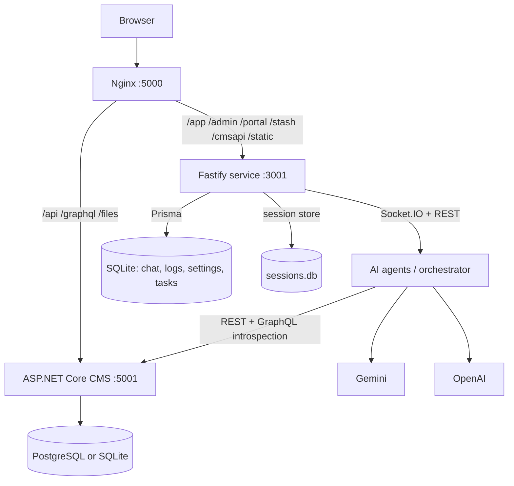

# CMS — AI-Powered Headless CMS & App Builder

CMS turns a natural-language prompt into a working data model, sample data, GraphQL queries, and server-rendered pages. It combines an AI orchestration service, a headless CMS runtime, four web apps, and an offline-first PWA in one product.

> **Two runtimes, one product.** The AI studio / BFF in this repository is **Node.js + Fastify + TypeScript**. It talks to a **separate ASP.NET Core CMS runtime** that owns entities, records, queries, pages, users, and assets. The Docker image bundles both runtimes. The .NET CMS source is **not part of this repository** — see [Architecture](./docs/wiki/Architecture.md) for the exact boundary.

---

## ✨ What you get

| Capability | What it does |
|---|---|
| **AI Studio** (`/app`) | Chat with specialised agents that design entities, seed data, build GraphQL queries, plan pages, and generate page components. |
| **Headless CMS** (`/api`, `/graphql`) | Automatically exposes REST and GraphQL APIs for every entity, with a visual admin, roles, audit logs, assets, and publishing. |
| **Admin** (`/admin`) | Manage content records, schemas, assets, background tasks, users, roles, and audit history. |
| **Portal** (`/portal`) | End-user area for notifications, reading history, likes, bookmarks, and subscriptions. |
| **Stash** (`/stash`) | Installable PWA with offline bookmarks, text-to-speech, media downloads/conversion, and a local player. |
| **SDK** (`@cms/sdk`) | React hooks, services, and routers for building CMS-backed frontends. |

---

## 🧭 Product surfaces

| URL | Served by | Purpose |
|---|---|---|
| `/app/` | Node/Fastify | CMS Studio: AI chat + entity/query/page editors + system settings |
| `/admin/` | Node/Fastify | CMS Admin |
| `/portal/` | Node/Fastify | End-user portal |
| `/stash/` | Node/Fastify | Offline-first PWA |
| `/static/` | Node/Fastify | Browser SDK injected into generated pages |
| `/cmsapi/*` | Node/Fastify | Chat, Socket.IO, AI providers, design styles, task queue |
| `/api/*` | ASP.NET Core CMS (proxied) | Auth, schemas, entities, queries, assets, engagement, portal APIs |
| `/graphql` | ASP.NET Core CMS (proxied) | GraphQL API and introspection |

---

## 🏗️ Architecture



The Fastify service is a **BFF + AI orchestrator**:

- validates the upstream CMS session cookie and forwards it on every CMS call;
- proxies `/api` and `/graphql` so the browser sees one origin;
- runs the agent pipeline over Socket.IO;
- stores chat history, AI response logs, system settings, design styles, and agent tasks in its own SQLite database;
- serves the compiled SPAs and the browser SDK.

See [Architecture](./docs/wiki/Architecture.md) for diagrams and data ownership.

---

## 📁 Repository layout

```text
packages/
  service/   Fastify BFF, AI agents, orchestrator, prompt resources, browser SDK
  app/       CMS Studio (React 19 + Vite + Tailwind + Monaco + React Flow)
  admin/     CMS Admin (React + PrimeReact)
  portal/    CMS Portal (React + PrimeReact + Stripe)
  stash/     CMS Stash PWA (React + Vite PWA + IndexedDB + Web Speech)
  sdk/       @cms/sdk — React hooks, services, routers (source-only workspace)
  shared/    DTOs, endpoint constants, socket events, API client, LayoutCompiler
  zen/       Standalone health-tracking demo app (not mounted by the main service)
  hello/     Minimal SPA used to test the Add SPA / folder-upload flow
mono-deploy-local/  Dockerfile, Compose, Nginx, entrypoint, fast build scripts
mono-deploy-hub/    Multi-arch Docker Hub publishing and production Compose
docs/               Wiki, deployment, migration, marketing, video tooling
```

Full breakdown: [Repository Structure](./docs/wiki/Repository-Structure.md).

---

## 🚀 Quick start (Docker)

The image bundles the Node service, the .NET CMS, Nginx, and ffmpeg. No local .NET or database installation is required.

```bash
docker run -d \
  --name cms \
  -p 5000:5000 \
  -v cms_data:/data \
  -e DATABASE_PROVIDER=0 \
  -e "CONNECTION_STRING=Data Source=/data/cms.db" \
  -e CMS_DATA_PATH=/data \
  -e "DATABASE_URL=file:/data/app/sqlite.db" \
  senthil455/cms-mono:latest
```

Open **http://localhost:5000/app/** and follow the setup wizard:

1. Choose/confirm the database.
2. Create the Super Admin.
3. Add a Gemini or OpenAI API key under **Settings → AI Providers**.
4. Start building.

Then try:

- *"Design entities for a library management system."*
- *"Add sample data for the books entity."*
- *"Create a query that lists all available books."*
- *"Build a book list page with search and an engagement bar."*

For PostgreSQL and production Compose, see [Docker Deployment](./docs/wiki/Docker-Deployment.md).

---

## 💻 Local development

### Prerequisites

- Node.js **20+** (Node 24 is used by the Docker image)
- npm 10+
- A running CMS backend at `CMS_BASE_URL` (default `http://127.0.0.1:5000`)

The easiest way to provide the CMS backend is to run the Docker image above on port `5000`; the local Studio uses its `/api` and `/graphql`, while the local Fastify service handles `/cmsapi`.

### Setup

```bash
git clone https://github.com/Senthil455/CMS.git
cd CMS
npm install
npm run setup          # builds @cms/shared, generates Prisma client, pushes SQLite schema
npm run dev            # Fastify service (:3001) + CMS Studio (:5173)
```

Open **http://127.0.0.1:5173/app/**.

> Use `127.0.0.1` consistently rather than mixing it with `localhost`; cookies are scoped per host.

### Run the other apps

```bash
npm run dev:admin      # http://127.0.0.1:5173/admin/
npm run dev:portal     # http://127.0.0.1:5173/portal/
npm run dev:stash      # http://127.0.0.1:5176/stash/
```

Admin and Portal do not define their own dev proxy. When developing them separately, either run one Vite app at a time or set `VITE_REACT_APP_API_URL` to the service origin. Stash proxies `/api` and `/graphql` to `:5000` and `/cmsapi` to `:3001`.

### Build

```bash
npm run build:shared
npm run build:app
npm run build:all      # builds every workspace that has a build script
```

`@cms/sdk` is consumed directly as TypeScript source and intentionally has no build step; `build:sdk` is therefore not a valid script.

See [Setup](./docs/wiki/Setup.md) for environment variables and troubleshooting.

---

## 🤖 How the AI pipeline works

The studio sends a chat message over Socket.IO. An intent classifier routes it to a specialist agent, or you can address an agent explicitly.

```text
User prompt
   │
   ├─ @agent trigger or intent classifier
   ▼
Agent.think() ──► AI provider ──► plan (JSON) ──► AiResponseLog
   │
   ▼
Agent.act() ──► writes to CMS via REST ──► schemas synced to the UI
   │
   ├─ needs confirmation? ──► chat:agent_plan_to_confirm ──► user confirms ──► finalize()
   └─ no confirmation ──► commit task item ──► next task item
```

| Agent | Responsibility |
|---|---|
| `system_architect` | Break a whole-app request into entity, query, and page tasks |
| `entity_designer` | Design entities, attributes, and relationships |
| `data_synthesizer` | Generate and insert realistic sample records |
| `query_builder` | Write GraphQL queries and save them as REST endpoints |
| `page_planner` | Choose the entity, page type, name, and design template |
| `page_architect` | Design the page layout and choose components |
| `component_builder` + page-component agents | Generate HTML for each page section |
| `intent_classifier` | Route free-form chat to the right agent |

Special chat commands: `@execute-task <id>`, `@replay <logId>`, `@modify-component <schemaId> <componentId> [requirement]`, and `@<agent_name>#<schemaId> ...`.

Details: [Orchestrator Strategy](./docs/wiki/Orchestrator-Strategy.md) · [Building a System](./docs/wiki/Building-a-System.md).

---

## ⚙️ Configuration

The Node service validates configuration with Zod at startup. Put values in `packages/service/.env` or the environment.

| Variable | Default | Purpose |
|---|---|---|
| `PORT` | `3001` | Fastify listen port |
| `DATABASE_URL` | `file:./dev.db` | Prisma SQLite database for service-owned data |
| `CMS_BASE_URL` | `http://127.0.0.1:5000` | Upstream CMS used for API calls and proxying |
| `CMS_PUBLIC_URL` | `http://127.0.0.1:5000` | Public CMS origin (reserved) |
| `FRONTEND_URL` | `http://localhost:5173` | Allowed CORS / Socket.IO origin |
| `SESSION_SECRET` | dev fallback | Session signing secret (32+ chars) |
| `SESSION_COOKIE_NAME` | `session` | Service session cookie name |
| `SESSION_MAX_AGE` | `86400000` | Session lifetime in ms |
| `GEMINI_API_URL` | Google Generative Language API | Gemini base URL |
| `GEMINI_USE_CACHING` | `false` | Enable Gemini context caching |
| `OPENAI_API_URL` | `https://api.openai.com/v1` | OpenAI base URL |
| `LOG_LEVEL_FASTIFY` | `warn` | Fastify/Pino level |
| `LOG_LEVEL_SERVICE` | `info` | Service logger level |
| `LOG_LEVEL_MODEL` | `info` | Agent/model logger level |
| `LOG_LEVEL_INFRASTRUCTURE` | `info` | Infrastructure logger level |

**AI API keys are not environment variables.** They are stored in the service SQLite database (`SystemSetting`) and managed from **Settings → AI Providers**. Keys are currently stored in plaintext, so protect the service database and restrict access to the studio.

Docker adds the .NET CMS variables (`DATABASE_PROVIDER`, `CONNECTION_STRING`, `CMS_DATA_PATH`, `CMS_MAX_REQUEST_SIZE`) and PostgreSQL settings. See [Docker Deployment](./docs/wiki/Docker-Deployment.md).

---

## 📚 Documentation

Start with the [Wiki home](./docs/wiki/Home.md).

| Guide | Description |
|---|---|
| [Setup](./docs/wiki/Setup.md) | Local development, Docker-backed backend, environment |
| [Architecture](./docs/wiki/Architecture.md) | Runtime topology, data ownership, request flows |
| [Repository Structure](./docs/wiki/Repository-Structure.md) | Every package and its role |
| [Building a System](./docs/wiki/Building-a-System.md) | Entity → data → query → page workflow |
| [Orchestrator Strategy](./docs/wiki/Orchestrator-Strategy.md) | Agents, task queue, confirmations, replay |
| [Page Templates & Interactivity](./docs/wiki/Page-Templates-Interactivity.md) | LayoutCompiler, Alpine.js, browser SDK |
| [Engagement Features](./docs/wiki/Engagement-Features.md) | Views, likes, shares, bookmarks, toplist |
| [API Reference](./docs/wiki/API-Reference.md) | Local `/cmsapi` routes, socket events, upstream API |
| [Docker Deployment](./docs/wiki/Docker-Deployment.md) | Image build, Nginx, volumes, troubleshooting |
| [Performance & Scalability](./docs/wiki/Performance-Scalability.md) | Actual characteristics and scaling guidance |
| [Contributing](./docs/wiki/Contributing.md) | Adding agents, components, routes, and prompts |
| [Stash](./docs/wiki/Stash.md) | PWA features, TTS, IndexedDB, offline behavior |
| [Vite + React + AI](./docs/wiki/Vite-React-Antigravity-Example.md) | Build an external frontend on CMS |
| [Migration Guide](./docs/migration-guide.md) | Move data and images between hosts |
| [Antigravity Integration](./docs/antigravity-integration.md) | Current AI-agent integration paths |

---

## 🗺️ Roadmap

| Phase | Focus | Status |
|---|---|---|
| **AI pipeline** | Entity, data, query, page, and component generation | ✅ Shipped |
| **Studio editing** | Visual schema graph, Monaco editors, API tester, publishing | ✅ Shipped |
| **Offline companion** | Stash PWA with TTS and media conversion | ✅ Shipped |
| **Enhanced AI** | Validation gates, retries, per-stage timeouts, token/cost tracking | 🚧 Planned |
| **Visual builder** | Drag-and-drop page composition and live preview | 🚧 Planned |
| **Marketplace** | Templates, community components, one-click install | 🚧 Planned |

The roadmap is intentionally modest: the current product is a working AI-assisted builder, not a fully no-code platform.

---

## 🛠️ Known limitations

- The **.NET CMS source is not in this repository**. Full-image builds expect a sibling `CMS`/`cms` checkout with a published `CMS.MonoApp`.
- The service stores AI keys in plaintext SQLite and performs **authentication only** — it does not enforce roles on `/cmsapi` admin routes.
- The agent task queue is global (no per-user ownership) and non-atomic.
- There is **no automated test suite** yet; `vitest` is configured but no tests exist.
- Generated pages depend on Tailwind, Alpine.js, and `marked` CDNs at runtime.
- The deployment scripts contain path assumptions documented in [Docker Deployment](./docs/wiki/Docker-Deployment.md).

---

## 👤 Made by

Built and maintained by **Senthil Raja R** <senthilrajasen637@gmail.com>.
See [AUTHORS.md](AUTHORS.md) and [LICENSE](LICENSE).
