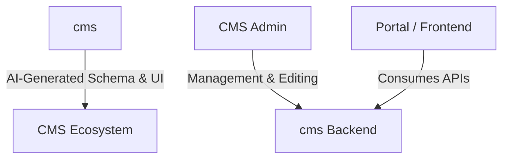

# CMS: The AI-Powered CMS

CMS is a cutting-edge, open-source Content Management System designed to revolutionize web development through AI. By automating the most tedious parts of development—schema design, data seeding, API creation, and UI building—CMS allows you to build complex, production-ready applications in minutes rather than weeks.

---

## ✨ Why CMS?

<table>
<tr>
<td align="center" width="33%">
<h3>🤖 AI-Powered</h3>
<p>Generate schemas, data, GraphQL queries, and full UI pages using natural language prompts. Let AI handle the tedious work while you focus on creativity.</p>
</td>
<td align="center" width="33%">
<h3>💬 Built-in Engagement</h3>
<p>Add engagement bars (views, likes, bookmarks, shares) and user avatars to any page with AI prompts. Social features are first-class citizens, not afterthoughts.</p>
</td>
<td align="center" width="33%">
<h3>🚀 Scalable & Performant</h3>
<p>P95 latency under 200ms, 2,400+ QPS throughput. Handle millions of posts with CDN caching and billions of user activities with horizontal sharding.</p>
</td>
</tr>
</table>

---

## ⚡ What You Can Do with AI

CMS isn't just a place to store content; it's an AI-driven development partner. 

### 1. Generate Entity (Schema)
Describe your business domain and AI will design normalized database schemas with relationships and appropriate data types.

### 2. Generate Data (Seeding)
Use AI to generate realistic, high-quality sample data that preserves relational integrity.

### 3. Generate Query (API)
Prompt the AI: "Give me all books published after 2020 by authors with more than 5 stars." It generates the GraphQL query and converts it into a REST endpoint automatically.

### 4. Generate Page (UI)
Go from prompt to page: "Build a landing page for my library that sections books by genre." AI generates the HTML/CSS and bridges it with your data queries.

### 5. Add Engagement Bar
Prompt: "Add likes, bookmarks, shares, and view count to my article page." AI integrates interactive social engagement features automatically.

### 6. Add User Avatar
Prompt: "Show the author's avatar and profile link." AI adds user identity components to your pages.

### 7. View History in Portal
Access all your generated schemas, queries, and pages in the portal. Compare versions and rollback changes anytime.

---

## 🎥 In Action

Watch CMS build a complete Library system (Entities, Data, Queries, and UI) from scratch in under 60 seconds (sped up 10x).


---

## 🟢 Live Demo

Try the live demo at [example.com/app](https://example.com/app).

**Credentials:**
- **Username:** `admin@example.com`
- **Password:** `Admin1!`

---

## 🚀 Quick Start

Get the project running locally in 4 steps.

### 1. Clone Repositories
You'll need both the core CMS and the AI agent.
```bash
git clone https://github.com/Senthil455/CMS
git clone https://github.com/Senthil455/CMS
```

### 2. Start Backend (CMS)
Run the core CMS with the SQLite demo.
```bash
cd cms/examples/SqliteDemo
dotnet run
```
_Verify that `http://127.0.0.1:5000` is accessible._

### 3. Configure Environment (CMS)
Open a new terminal and set up the AI agent with your Gemini API key.
```bash
cd cms/packages/backend
cp .env.example .env
```
Edit `.env` and add your key (you can get a free one [here](https://aistudio.google.com/app/apikey)):
```ini
GEMINI_API_KEY=your_key_here
```

### 4. Start Development Server
Run the CMS agent.
```bash
# From cms root
npm run dev
```
Visit **http://127.0.0.1:5173** to start building!

> **Note:** Please use `127.0.0.1` instead of `localhost` to ensure cookies are shared correctly.

### 💡 Try it out
Once running, try these prompts:
- "Design entities for a library management system"
- "Add sample data for the book entity"
- "Create a query to display all available books"

---

## 🏗️ Architecture

CMS is built on a modern, decoupled architecture designed for performance and flexibility.



### Overview of the Components

| Repos             | Overview                                                                | 
| ----------------- | ----------------------------------------------------------------------- | 
| Formmatte         | schema + UI builder that produces JSON schema/config  AI                | 
| cms (backend) | CMS backend with entities, GraphQL/REST, assets, and engagement features | 
| CMS Admin SDK   | React SDK that talks to the backend, handles admin state and APIs       |
| CMS Admin   | React admin panel for managing content data                             | 
| CMS Portal     | User portal for view history, liked items, and bookmarked content       | 

📖 **[See Wiki for detailed architecture documentation →](../../wiki)**
