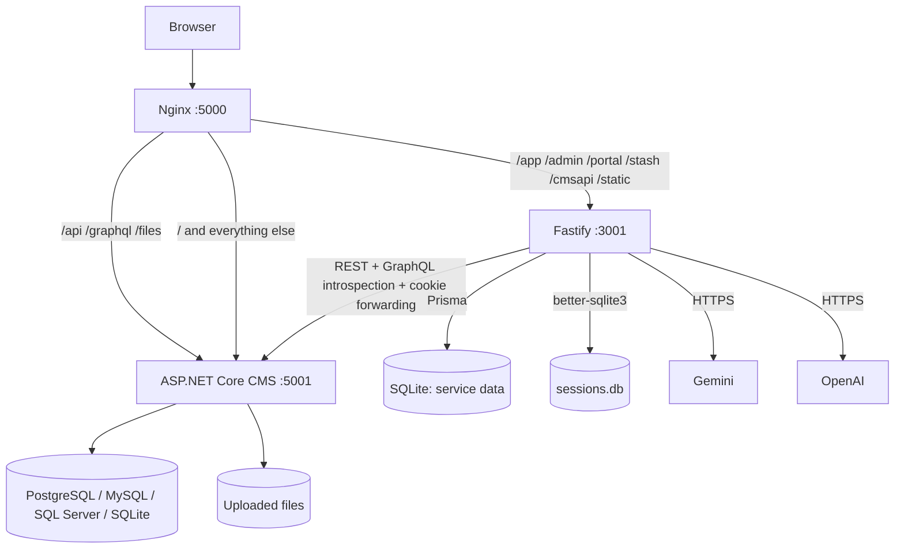

# Architecture

CMS is **two runtimes behind one origin**. The repository contains the Node.js/Fastify AI studio and BFF; the ASP.NET Core CMS runtime is a separate application that owns entities, records, queries, pages, users, and assets.

---

## 1. Runtime topology



In local development without Nginx, the browser talks to Vite, and Vite proxies the same prefixes to `:5000` (CMS) and `:3001` (Node). See [Setup](./Setup.md).

---

## 2. What each runtime owns

### Fastify service (`packages/service`)

| Responsibility | Implementation |
|---|---|
| Authentication context | Reads the CMS session cookie and calls the CMS `/api/me` to populate `request.user` |
| CMS proxying | `/api/` and `/graphql` via `@fastify/http-proxy` |
| AI orchestration | Intent classifier, specialist agents, task queue, replay, cancellation |
| Chat transport | Socket.IO at `/cmsapi/socket.io` |
| Service data | Prisma + SQLite: `ChatMessage`, `AiResponseLog`, `SystemSetting`, `DesignStyle`, `AgentTask` |
| Session store | `better-sqlite3` + `fastify-session-better-sqlite3-store` in `sessions.db` |
| Credentials | Gemini/OpenAI keys in `SystemSetting`, updated in memory on save |
| Static hosting | `/app/`, `/admin/`, `/portal/`, `/stash/`, `/static/` plus SPA fallbacks |

### ASP.NET Core CMS (external to this repository)

| Responsibility | Notes |
|---|---|
| Users, login, registration, profile | The service does not issue CMS identities; it forwards the CMS cookie |
| Schemas/entities and relationships | Entity records, lookups, junctions, collections |
| Named GraphQL queries | Saved as query schemas; REST endpoints under `/api/queries/:id` |
| Pages | Templates/layout metadata and published HTML |
| Assets | Upload, metadata, video/audio conversion endpoints |
| Engagement | Likes, shares, bookmarks, visits, toplist, notifications |
| Portal features | Reading history, subscriptions, Stripe session endpoints |
| Background tasks | Import/export/emit task endpoints |
| Database | PostgreSQL, MySQL, SQL Server, or SQLite |

The service treats the CMS as the source of truth. It never writes directly to the CMS database; all mutations go through CMS REST/GraphQL endpoints with the caller's cookie.

---

## 3. Request flows

### Page and asset requests

```text
Browser → Nginx
  ├─ /app/*      → Fastify → packages/app/dist
  ├─ /admin/*    → Fastify → packages/admin/dist
  ├─ /portal/*   → Fastify → packages/portal/dist
  ├─ /stash/*    → Fastify → packages/stash/dist
  ├─ /static/*   → Fastify → packages/service/public/static
  ├─ /api/*      → .NET CMS
  ├─ /graphql    → .NET CMS
  ├─ /files/*    → .NET CMS
  └─ /*          → .NET CMS (CMS-rendered pages and setup UI)
```

The Fastify SPA fallback returns the corresponding `index.html` for any unmatched path under `/app`, `/admin`, `/portal`, or `/stash`. Unknown paths outside those prefixes receive a JSON `404`.

### Chat and agent flow

```text
Studio → Socket.IO /cmsapi/socket.io
  → session/auth middleware validates CMS cookie
  → OrchestratorService.processInput
      → special command? replay / execute-task / modify-component
      → explicit @agent trigger, else intent_classifier
      → agent.think()  → AI provider → JSON plan → AiResponseLog
      → agent.act()    → CMS REST calls  → schemas synced
      → feedback needed? chat:agent_plan_to_confirm
      → otherwise commit task item and run the next one
  → chat:message_received / chat:agent_status / chat:schemas_sync
```

### CMS proxy flow

`/api/*` and `/graphql` are transparent reverse proxies. They do not add authentication; the browser's CMS cookie flows through unchanged. This is why the Studio works when it is served from the same origin as the CMS.

---

## 4. Generated pages

Pages are **generated HTML documents**, not Handlebars rendered by the Node service.

1. Page agents produce layout sections and component HTML.
2. `LayoutCompiler` in `@cms/shared` assembles a full document: `<head>` with CDN scripts, a 12-column Tailwind grid, and each component wrapped in `data-component-id`.
3. The compiled HTML is saved to the CMS as the page source.
4. At runtime, the browser loads Tailwind, Alpine.js, `marked`, and `/static/index.js` (the browser SDK) from the page `<head>`.
5. Alpine directives and the SDK provide interactivity: engagement stats, bookmarks, login dialogs, visit tracking.

There is no server-side Handlebars execution in this repository. See [Page Templates & Interactivity](./Page-Templates-Interactivity.md).

---

## 5. Data ownership and consistency

| Data | Owner | Backup |
|---|---|---|
| Entities, records, queries, pages | CMS database | CMS-native backup; `pg_dump` for PostgreSQL |
| Users, roles, sessions | CMS database | Same |
| Uploaded assets | CMS data path (`/data/files` in Docker) | Volume backup |
| Chat history, AI logs, tasks, settings, design styles | Service SQLite (`DATABASE_URL`) | Volume backup (`/data/app/sqlite.db`) |
| Service session store | `sessions.db` | Optional; users can re-authenticate |
| Generated frontends uploaded through Add SPA | CMS data/apps directory | Volume backup |

The two databases are **not transactionally linked**. If a CMS write succeeds and the service crashes before recording task state, the UI can show stale task progress. Re-running the task or using `@replay` is the recovery path.

---

## 6. Security boundaries

| Boundary | Current behavior |
|---|---|
| Browser → Fastify `/cmsapi` | Requires a valid CMS session; no role check |
| Browser → CMS `/api`, `/graphql` | Enforced by the CMS (auth, roles, publication rules) |
| Fastify → CMS | Forwards the caller's cookie; no service-to-service credential |
| AI provider keys | Plaintext in `SystemSetting`; masked in API responses |
| Socket.IO | Cookie-authenticated during the handshake; CORS restricted to `FRONTEND_URL` variants |
| Session cookie | `httpOnly`, `sameSite=lax`, `secure: false` (must be changed behind HTTPS in production) |
| CORS | `FRONTEND_URL` plus localhost/127.0.0.1 variants, credentials enabled |

Because `/cmsapi` performs authentication only, any logged-in CMS user can read AI logs, change provider keys, edit design styles, and toggle tasks. Deploy the Studio behind trusted access control until role enforcement is added.

---

## 7. Design constraints

- **Single origin in production.** Nginx routes both runtimes under port 5000, avoiding cross-origin cookie problems.
- **SQLite for service state.** Simple and portable, but single-writer; not suitable for horizontal scaling of the Node service without replacing the Prisma datasource and session store.
- **Global task queue.** `AgentTask` rows are not scoped to a user; the newest task is visible to all Studio users.
- **In-process orchestration.** Cancellation and status live in memory (`activeRequests`, `StatusService`), so a restart loses in-flight state and a second Node replica would not see it.
- **CDN dependencies in generated pages.** Tailwind, Alpine, `marked`, and Google Fonts are loaded externally at runtime.

---

## 8. Related reading

- [Repository Structure](./Repository-Structure.md) — package-by-package map
- [API Reference](./API-Reference.md) — local routes, socket events, proxied CMS APIs
- [Docker Deployment](./Docker-Deployment.md) — how the two runtimes are packaged
- [Performance & Scalability](./Performance-Scalability.md) — real limits and scaling options
